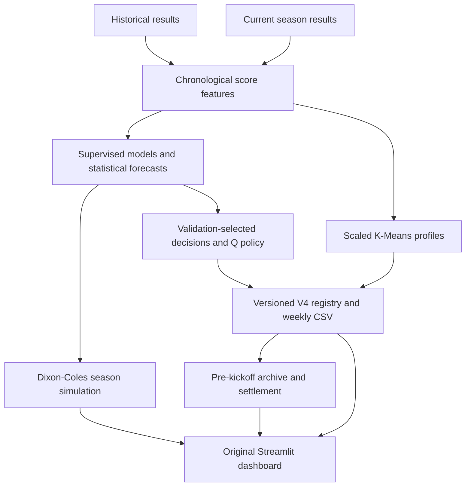

# Architecture

Research scripts `accuracy_v3.py` through `accuracy_v39.py` are separate from `production_v4.py`. V4 uses 85 score-based features; the 184-feature research experiments are not automatically deployed. The active registry pointer is `models/v4/active.txt`; each version contains `bundle.joblib`, `manifest.json`, `validation.csv`. Historical predictions are saved under `outputs/v4_production/<version>/historical_predictions.csv`. `refresh_v4.py` reads the registry and current-season schedule, simulates remaining fixtures, generates upcoming forecasts and settles archives. The original `app.py` and seven modular pages remain the UI entry point. `dashboard/v4_data.py` adapts saved V4 data; research tables appear within Model Comparison. The separate `app_v4.py` is not the primary interface.

Production model decisions and probability forecasts are separate: `Primary_P_*` belongs to the primary decision model, `Outcome_P_*` to the selected probability model, `Q_P_*` to the Q policy. A modal exact score need not imply the same aggregate outcome as the primary classifier. Registry selection is frozen until retraining; current match features update on refresh. Archived first valid forecasts are used for live evaluation, not retrospectively generated forecasts.
